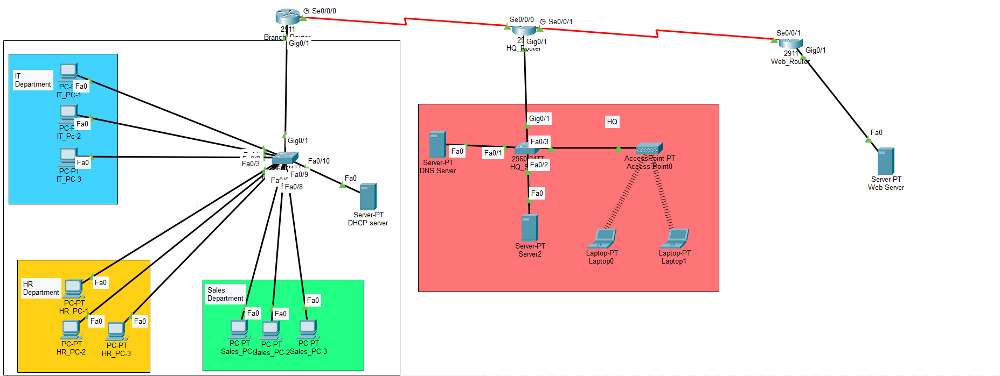

# Enterprise Multi-Site WAN Infrastructure & Departmental Network

An enterprise-grade network simulation model connecting a corporate Branch Office to a central Headquarters (HQ) and an isolated Web/DMZ perimeter network. Designed and configured using **Cisco Packet Tracer**.

---

## 📌 Architecture Overview

This infrastructure demonstrates realistic corporate networking requirements, including departmental traffic segmentation, point-to-point WAN connectivity, centralized enterprise services, and wireless client support.

---

## 🛠️ Key Network Components & Features

### 1. Multi-Site WAN Connectivity
- **Branch & HQ Interconnection:** Connected via high-speed Serial WAN links (`Se0/0/0` / `Se0/0/1`) between Cisco 2911 ISR routers.
- **Perimeter / DMZ Routing:** Route integration toward an edge Web Router hosting public/enterprise server infrastructure.

### 2. Departmental Local Area Network (Branch)
- **Segmentation:** End-user hosts logically separated across departmental domains:
  - **IT Department** (`IT_PC-1`, `IT_PC-2`, `IT_PC-3`)
  - **HR Department** (`HR_PC-1`, `HR_PC-2`, `HR_PC-3`)
  - **Sales Department** (`Sales_PC-1`, `Sales_PC-2`, `Sales_PC-3`)
- **Switch Infrastructure:** Centrally aggregated via a Cisco Catalyst 2960 switch with dedicated access ports and default gateway routing.

### 3. Centralized Enterprise Services (HQ)
- **Core Corporate Servers:** Integrated DNS and enterprise application servers (`Server0`, `Server-PT DNS`, `Server-PT Server2`).
- **Wireless Infrastructure:** Deployed 802.11 Wireless Access Point (`AccessPoint0`) providing secured Wi-Fi connectivity for roaming mobile laptops (`Laptop0`, `Laptop1`).

---

## 🔍 Diagnostics & Verification
- Validated end-to-end ICMP reachability (`ping` / `traceroute`) between Branch departments and HQ core services.
- Tested DNS resolution and default routing paths across WAN interfaces.

---

## 📁 Repository Contents
- `enterprize architecute.pkt` – Cisco Packet Tracer simulation topology file.
- `topology.png` – High-resolution network architecture diagram.

---
*Created by Sunera Bandara | BICT Undergraduate, University of Colombo*
